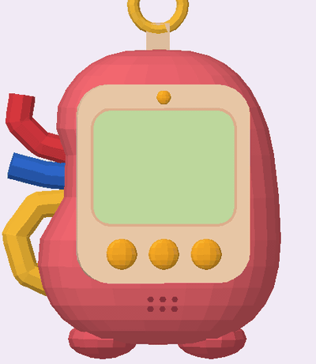
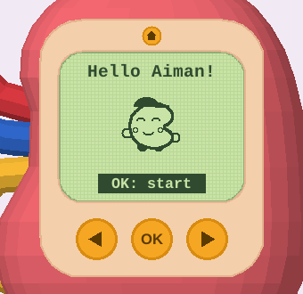
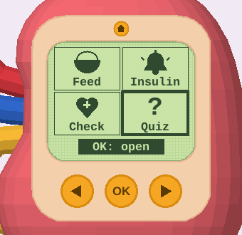
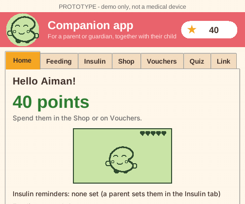
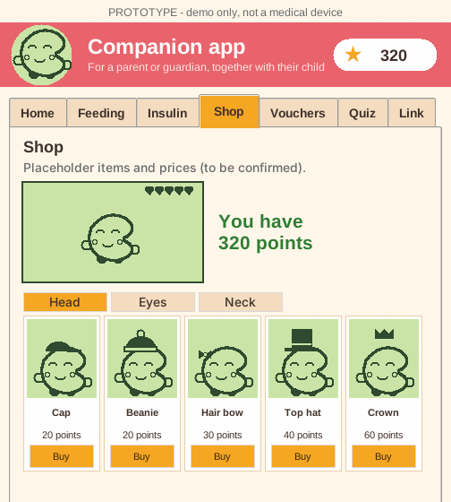
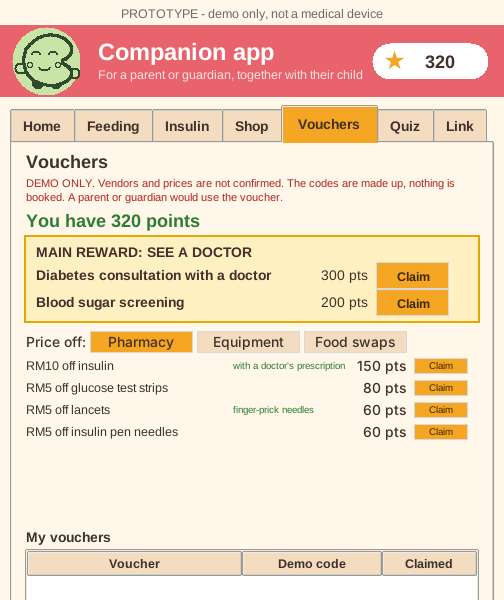

# Suggy: a diabetes keychain pet for kids

Suggy is a prototype made for the **Diabetes X Innovation Hackathon (MIT Hacking Medicine Malaysia 2026)**, in the track *"Reimagining the Future of Diabetes Prevention and Early Care"*.

It is a keychain pet for **kids aged 6 to 14**, with a **companion app for their parent or guardian**. Kids look after Suggy, a little kidney character, and learn about food and blood sugar by playing. Kids who take insulin get a gentle reminder at the times their parent sets.

> **Prototype only.** The keychain is simulated in a desktop window because we have no hardware yet. This is not a medical device. It never shows insulin doses and gives no medical advice.



## What it does

**Keychain (for the kid)**

- **Feed Suggy:** pick a meal, a drink and a dessert from two choices each, and learn which choices give slow, steady energy.
- **Insulin reminder:** "Insulin time!" pops up at the times a parent set, then counts down to "Time to eat!".
- **Check on Suggy:** see how Suggy is feeling after the day's food choices.
- **Kids' quiz:** three quick yes/no questions with a fun fact each.

**Companion app (for the parent)**

- Link the keychain with the child's nickname, IC number and the keychain's reference number. The IC number is only checked, never saved.
- Set insulin reminder times and see when the kid pressed OK.
- Points from light food choices and quizzes buy cosmetics for Suggy in the shop, or demo vouchers (for example money off brown rice instead of white rice, or a doctor consultation).

| Feeding | Insulin reminder | Kids' quiz |
|---|---|---|
|  |  |  |

| Points and confetti | Shop | Vouchers |
|---|---|---|
|  |  |  |

## How to run it

You only need **Python 3** (3.10 or newer). Nothing else to install: everything uses Python's built-in Tkinter.

```bash
# Window 1: the keychain
cd keychain
python main.py

# Window 2: the companion app
cd adult-app
python main.py
```

Run both at the same time. They share one file, `data/state.json`, so what you do in the app shows on the keychain within a second.

**Keychain controls:** drag with the mouse to turn it. Left and Right arrow keys move between choices, Enter or Space is OK, H or Esc goes Home.

**Demo tip:** in the app's Link tab, use a made-up IC number such as `150301-10-1234` and the reference `KC-4821`.

## Folders

| Folder | What is inside |
|---|---|
| `keychain/` | The simulated keychain: 3D viewer, screens, feeding, insulin reminder, quiz |
| `adult-app/` | The parent's companion app (tabs: Home, Feeding, Insulin, Shop, Vouchers, Quiz, Link) |
| `data/` | `state.json`, the shared data file |
| `docs/` | `flow.md` (how everything works) and `data-format.md` (every key in `state.json`) |
| `gifs/`, `screenshots/` | Pictures for the presentation |

## Notes

- Prices, points, vouchers and voucher codes are placeholders for the demo.
- Quiz questions were written for the prototype and still need review by a health professional.
